# Physical Verification using SKY130A

## Lab 1: CMOS Inverter

This project documents the design, simulation, layout, and physical verification of a CMOS inverter using the SKY130A open-source PDK.

The work was carried out in Ubuntu Linux using Xschem, ngspice, Magic, and Netgen. The lab includes schematic capture, PWL and pulse transient simulations, layout creation, DRC, and an attempted LVS comparison.

## Tools Used

| Tool | Purpose |
|---|---|
| Ubuntu Linux | Development environment |
| SKY130A PDK | Process technology and transistor models |
| Xschem | Schematic capture |
| ngspice | Transient simulation |
| Magic | Layout design and DRC |
| Netgen | Layout-versus-schematic comparison |
| Git | Version control |

## Repository Structure

```text
Physical_Verification_SKY130A/
├── README.md
└── Lab1_inverter/
    ├── xschem/
    │   ├── inv.sch
    │   └── inv.sym
    ├── mag/
    │   └── inv.mag
    ├── ngspice/
    │   ├── inverter.spice
    │   └── inv_tb_fixed.spice
    ├── netgen/
    └── screenshots/
```

## 1. Environment Setup

The project was developed in Ubuntu Linux running inside VirtualBox.

The SKY130A PDK was installed using Volare. The PDK version used in this environment was:

`c6d73a35f524070e85faff4a6a9eef49553ebc2b`

### Check tool availability

```bash
xschem --version
ngspice --version
magic --version
command -v netgen-lvs
```

### Configure the PDK

```bash
export PDK_ROOT="$HOME/.volare/volare/sky130/versions/c6d73a35f524070e85faff4a6a9eef49553ebc2b"
```

Check that the PDK is available:

```bash
ls "$PDK_ROOT/sky130A"
```
<p align="center">
  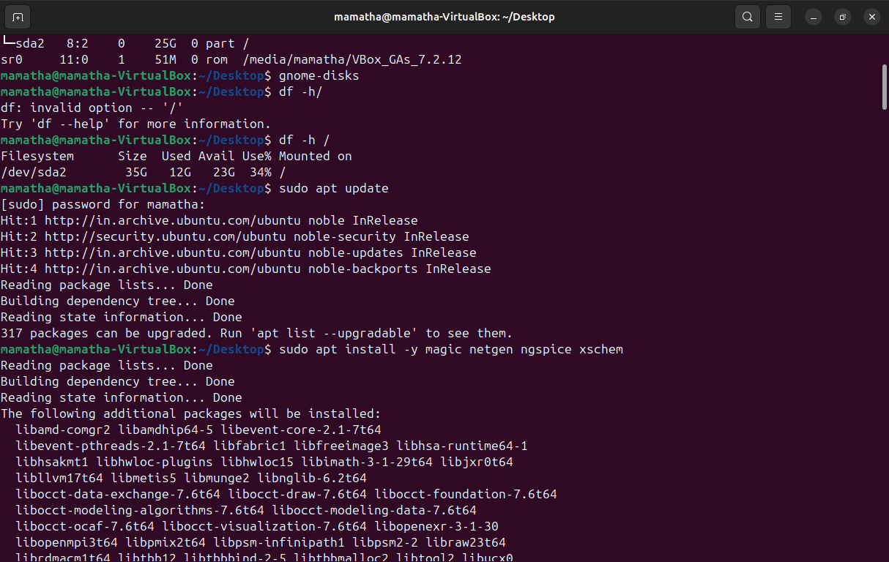
</p>
### Launch Xschem

```bash
xschem --rcfile "$PDK_ROOT/sky130A/libs.tech/xschem/xschemrc"
```
<p align="center">
  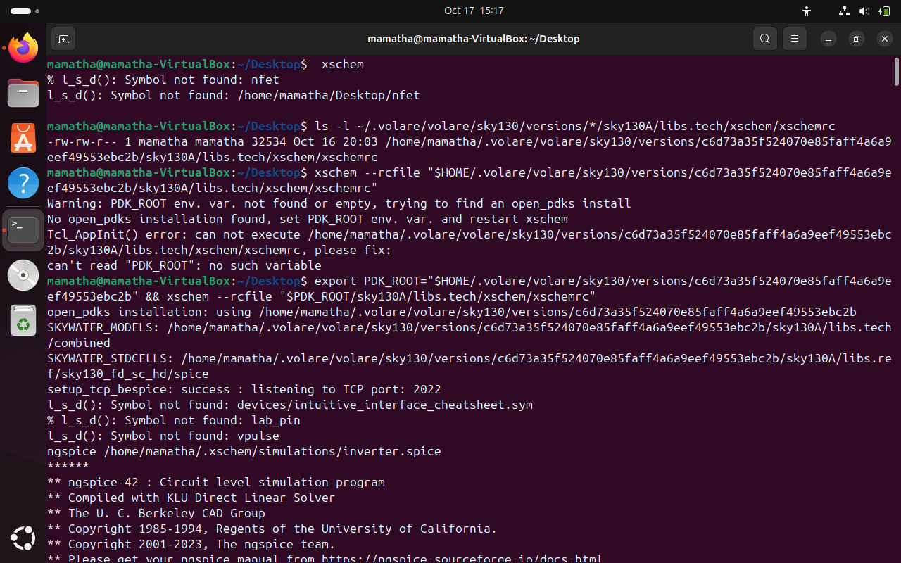
</p>
Open the inverter schematic:

`Lab1_inverter/xschem/inv.sch`

### Launch Magic

The development environment uses the Magic startup file `~/sky130A.magicrc`.

```bash
magic -rcfile "$HOME/sky130A.magicrc"
```

Load the layout file:

`Lab1_inverter/mag/inv.mag`
<p align="center">
  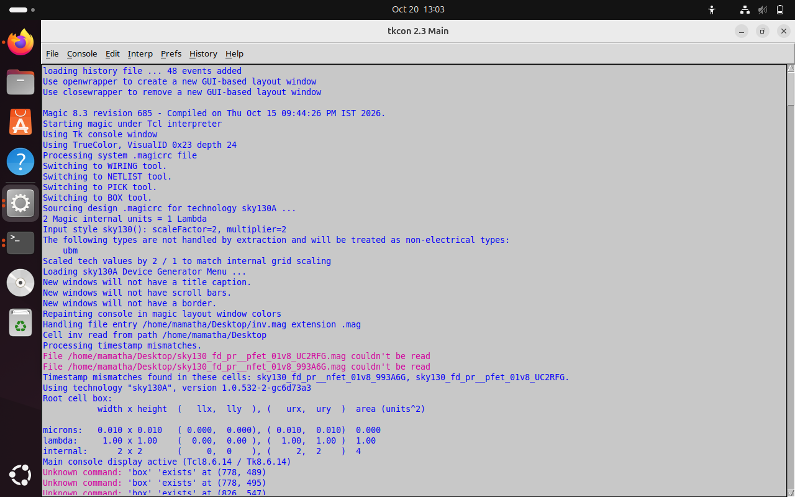
</p>
These commands use the paths from the original development environment. Different installations may require path changes.

## 2. Schematic Design

The CMOS inverter schematic was created using Xschem.

The circuit consists of an NMOS pull-down transistor and a PMOS pull-up transistor. Their gates form the input, and their drains form the output. The PMOS is connected to the positive supply, while the NMOS is connected to ground.

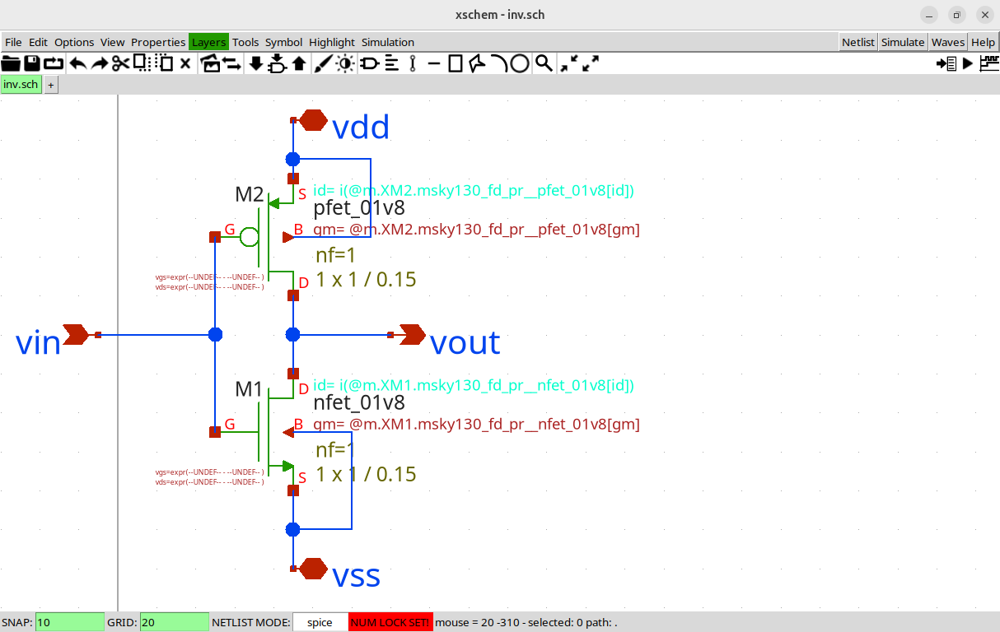

**Schematic file:** `Lab1_inverter/xschem/inv.sch`

## 3. Inverter Testbench

A testbench was used to apply input signals to the CMOS inverter and observe its transient response.

### Testbench Setup

<p align="center">
  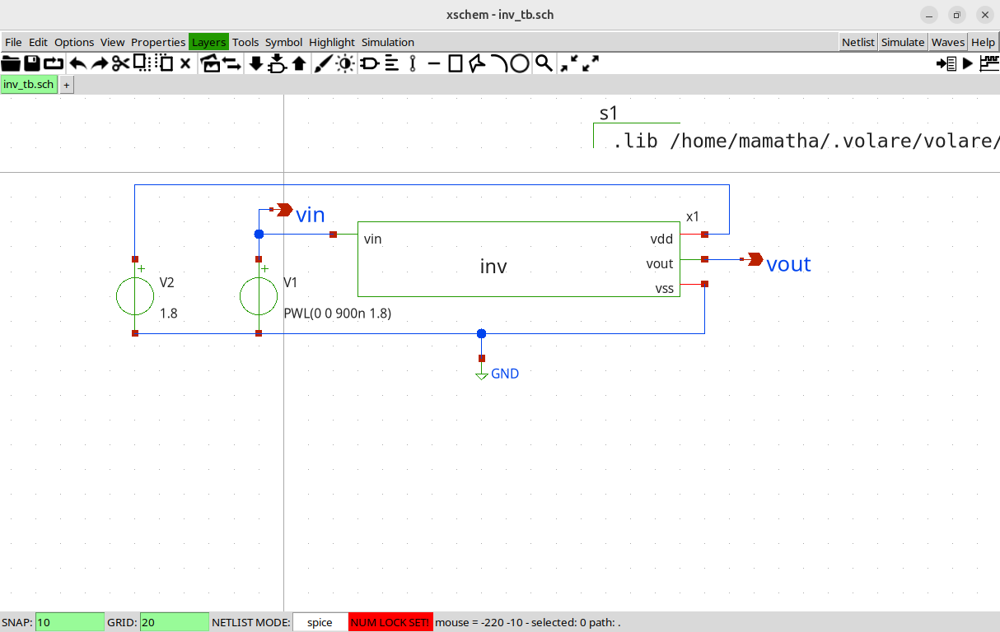
</p>


## 4. PWL Transient Simulation

The standalone SPICE netlist applies a piecewise-linear (PWL) input ramp from 0 V to 1.8 V over 900 ns.

### Simulation parameters

| Parameter | Value |
|---|---|
| Supply voltage | 1.8 V |
| Initial input voltage | 0 V |
| Final input voltage | 1.8 V |
| Ramp duration | 900 ns |
| Transient step | 1 ns |
| Stop time | 1 µs |

The input source is defined as:

```spice
VIN vin 0 PWL(0 0 900n 1.8)
```

The transient analysis command is:

```spice
tran 1n 1u
```
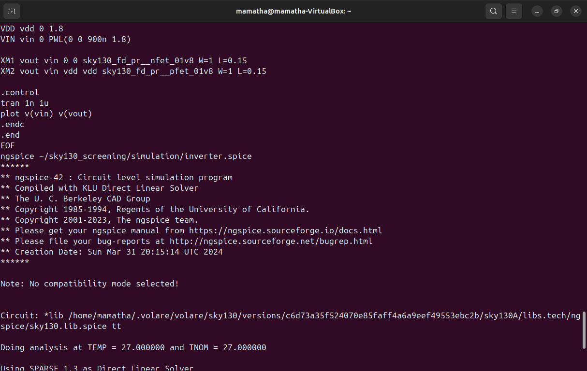
### Run the simulation

From the repository root:

```bash
ngspice Lab1_inverter/ngspice/inverter.spice
```

The netlist loads the SKY130A transistor models, defines the inverter, runs transient analysis, and plots the input and output voltages.


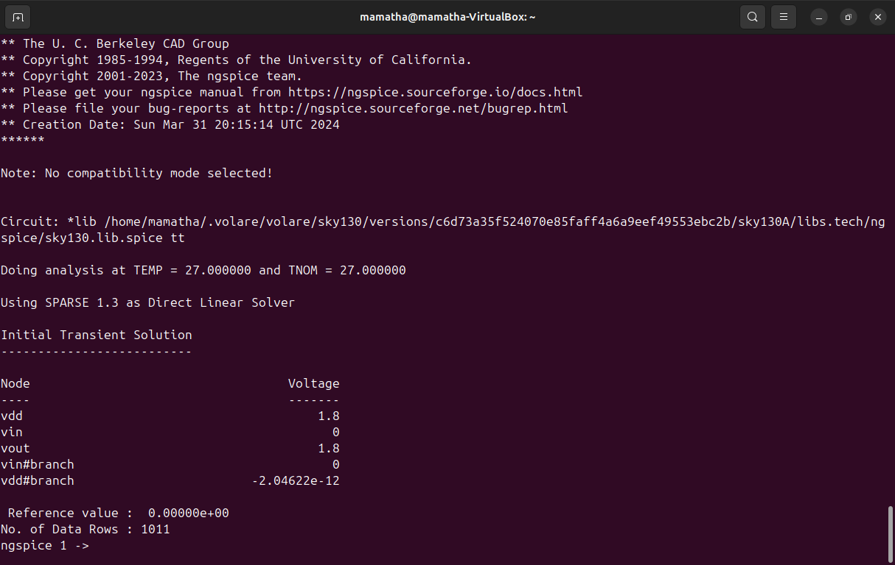  

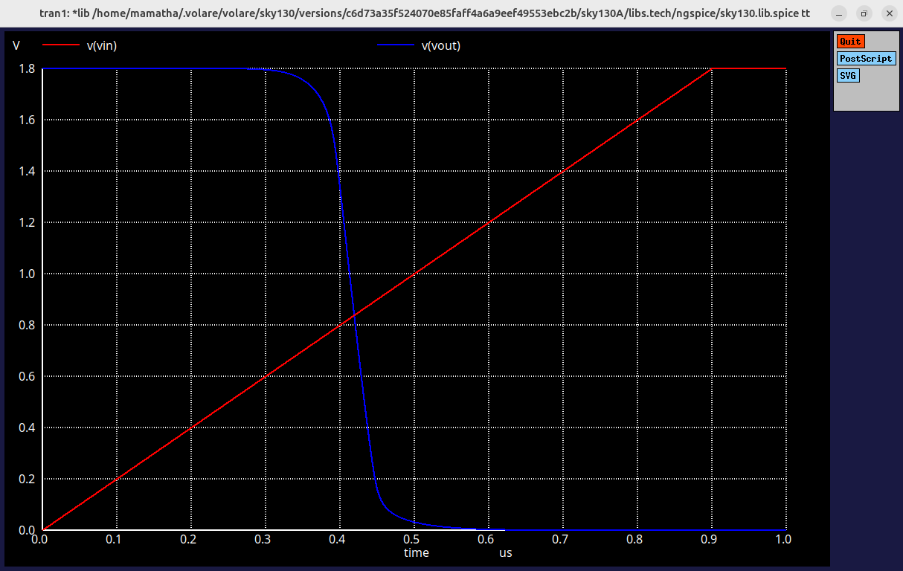

**Simulation file:** `Lab1_inverter/ngspice/inverter.spice`

## 5. Pulse Transient Simulation

A second testbench uses a periodic pulse input to examine the inverter response to repeated input transitions.

The pulse source in the Xschem-generated testbench is:

```spice
V1 vin GND PULSE(0 1.8 0 100p 100p 10n 20n)
```

The source specifies a low voltage of 0 V, a high voltage of 1.8 V, rise and fall times of 100 ps, a pulse width of 10 ns, and a period of 20 ns.

The testbench uses a 1.8 V supply and a transient stop time of 40 ns.

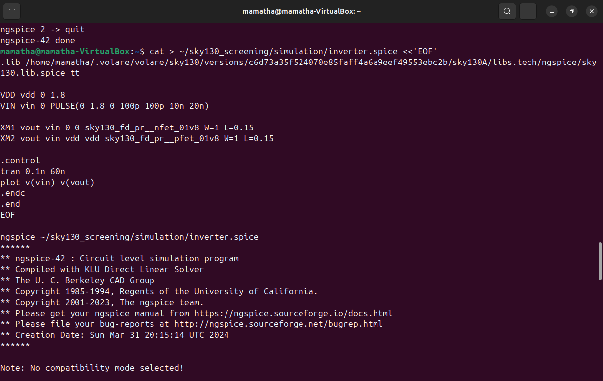

### Run the testbench

```bash
ngspice Lab1_inverter/ngspice/inv_tb_fixed.spice
```

The recorded simulation produced a square-wave response. The input and output connections should be checked against the current schematic when interpreting the result.


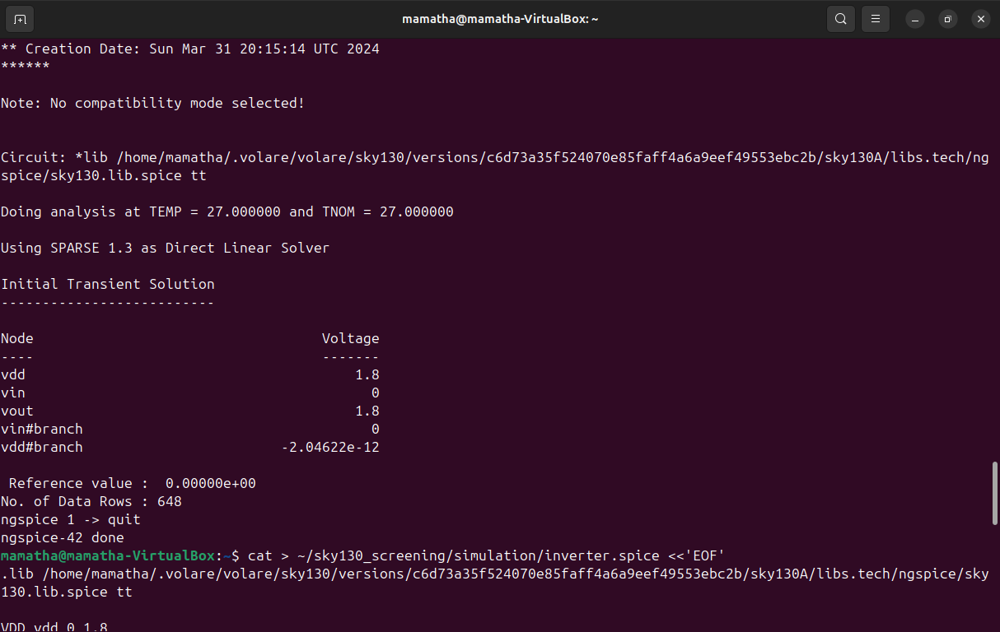

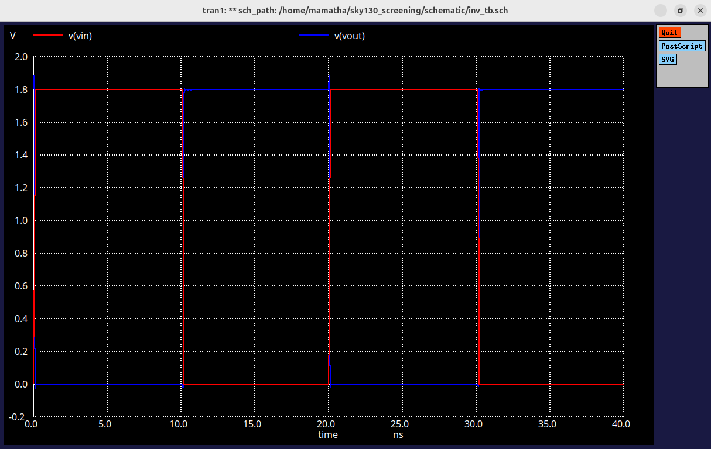
**Testbench file:** `Lab1_inverter/ngspice/inv_tb_fixed.spice`

## 6. Layout Design Using Magic

The inverter layout was created in Magic using the SKY130A technology.

The native Magic layout file is included in this repository.

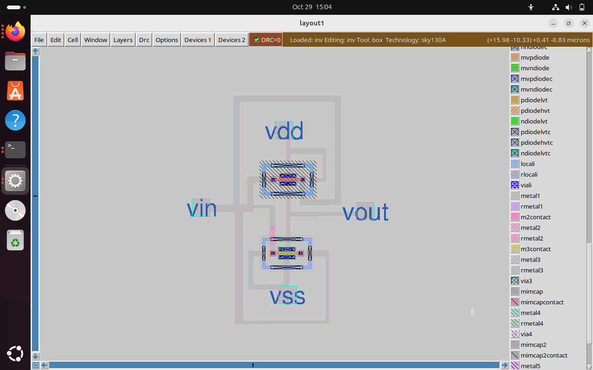

**Layout file:** `Lab1_inverter/mag/inv.mag`

### Useful Magic commands

The following commands were used during layout inspection and verification:

```tcl
save
drc check
drc count
extract all
ext2spice lvs
ext2spice
```

- `save` saves the current layout.
- `drc check` checks the layout against the configured design rules.
- `drc count` reports the DRC error count.
- `extract all` extracts layout connectivity.
- `ext2spice lvs` configures extraction for LVS.
- `ext2spice` exports the extracted circuit to SPICE.

## 7. Design Rule Check (DRC)

DRC was performed in Magic to check the layout against the configured design rules.

The command used to inspect the result was:

```tcl
drc count
```

The recorded output was:

```text
Total DRC errors found: 0
```

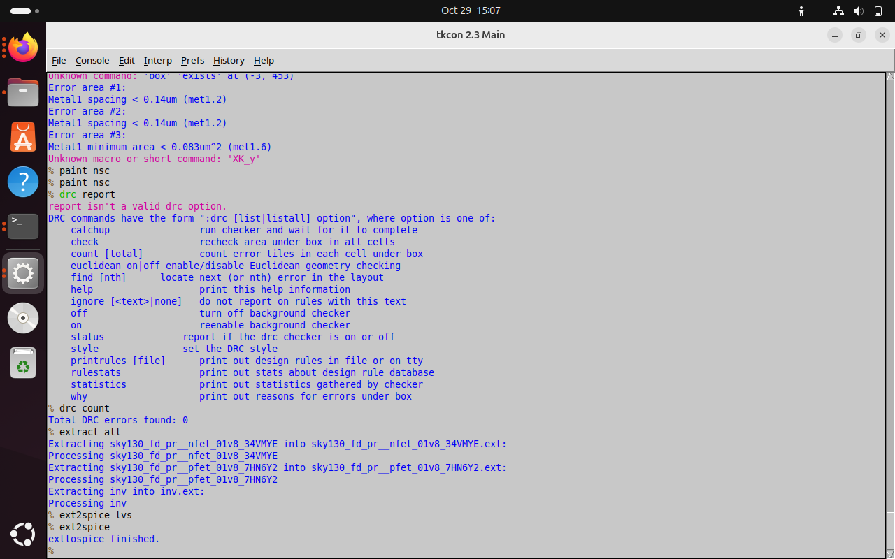

Zero reported DRC errors means no violations were reported by this check. It does not establish that the layout connectivity matches the schematic.

## 8. Layout Versus Schematic (LVS)

Layout Versus Schematic (LVS) verification was performed using Netgen to compare the extracted CMOS inverter layout netlist against the reference schematic netlist.

The layout extraction workflow in Magic included the following commands:

```tcl
extract all
ext2spice lvs
ext2spice
```

LVS verification was performed using the `netgen-lvs` executable and the SKY130A Netgen setup file.

The following command structure was used for LVS comparison:

```bash
netgen-lvs -batch lvs \
  "/path/to/schematic.spice inv" \
  "/path/to/layout.spice inv" \
  "/path/to/sky130A_setup.tcl"
```

The placeholder paths should be replaced with the actual file paths when reproducing the verification.

### LVS Result

**Result: PASSED**

The Netgen comparison reported:

```text
Circuits match uniquely.
Netlists match uniquely.
```

This indicates that the two netlists used in the successful comparison were equivalent.

The LVS verification result is documented below:


The `mag/` directory contains the Magic layout and associated extraction files. The reference schematic and netlist are maintained in the `xschem/` and `netlists/` directories, respectively.
## 9. Results

| Activity | Result |
|---|---|
| Schematic capture | Completed |
| PWL transient simulation | Executed |
| Pulse transient simulation | Executed |
| Layout design | Created |
| DRC | Zero errors reported |
| LVS comparison | Completed using Netgen|
| Final LVS equivalence | Passed — netlists and circuits match uniquely|

## 10. Next Steps

- Investigate the unintended net merges found during extraction.
- Correct the layout connectivity.
- Repeat extraction after making corrections.
- Run LVS again against the reference schematic.
- Include the final LVS report after successful verification.

## References

- [SkyWater SKY130 PDK Documentation](https://skywater-pdk.readthedocs.io/)
- [Xschem](https://xschem.sourceforge.io/)
- [ngspice](https://ngspice.sourceforge.io/)
- [Magic VLSI](http://opencircuitdesign.com/magic/)
- [Netgen](http://opencircuitdesign.com/netgen/)
